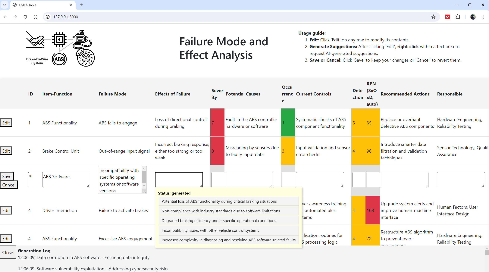

# FMEA Assisted by LLM System

Failure Mode and Effects Analysis (FMEA) is a systematic method used to identify and address potential failures in products or industrial processes. This project demonstrates how Large Language Models (LLMs) can significantly enhance the traditional FMEA process, automating it to ensure higher safety, quality, and reliability while reducing the dependency on extensive expert input and labor-intensive analyses.

- **Demo**: Access the runnable demo [https://llm-fmea-assistant-v2-yawjvp4zbq-ew.a.run.app](https://llm-fmea-assistant-v2-yawjvp4zbq-ew.a.run.app).
- 
## Related Dissertation
This work is part of the doctoral research summarized in the Ph.D. dissertation:

> Y. Xia, **Integrating Large Language Model Agents with Digital Twins for Industrial Autonomous Systems**, Doctoral Dissertation, University of Stuttgart, 2026.
>
> which presents a general framework for integrating LLMs, digital twins, and automation systems into industrial autonomous systems, including synthesised theories and multiple industrial case studies.
>
> Dissertation (Open-access): https://doi.org/10.18419/opus-18222

# Project Demonstrations
This repository contains demonstrations of LLM-assisted FMEA in distinct applications:

## 1. Brake-by-Wire System Analysis
In this demonstration, we apply an LLM to analyze the brake-by-wire system, a critical component in modern vehicles. The model identifies potential failure modes and suggests risk mitigation strategies, facilitating a more resilient design.

## About the Author
<a href="https://yuchenxia.com" target="_blank">Yuchen Xia, Ph.D.</a> specializes in LLM agents, digital twins, and industrial automation since 2021. You can find more about his work, publications and projects on his <a href="https://yuchenxia.github.io/" target="_blank">personal website</a>.
